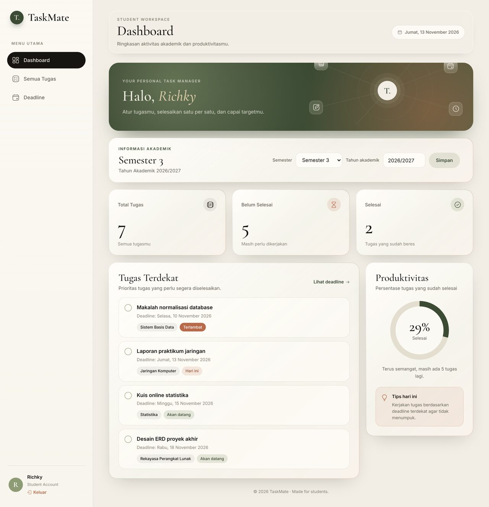
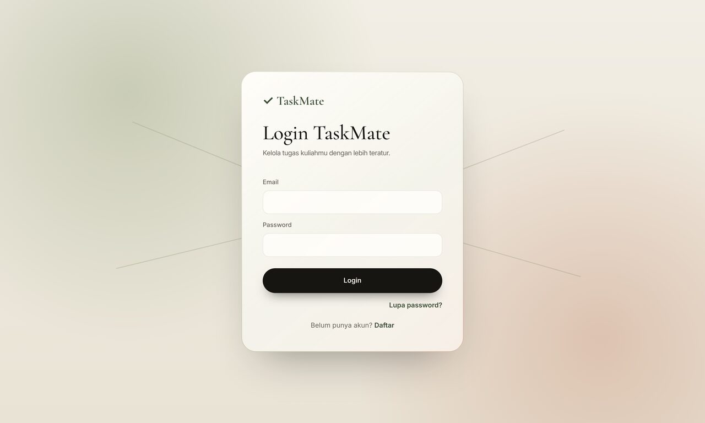
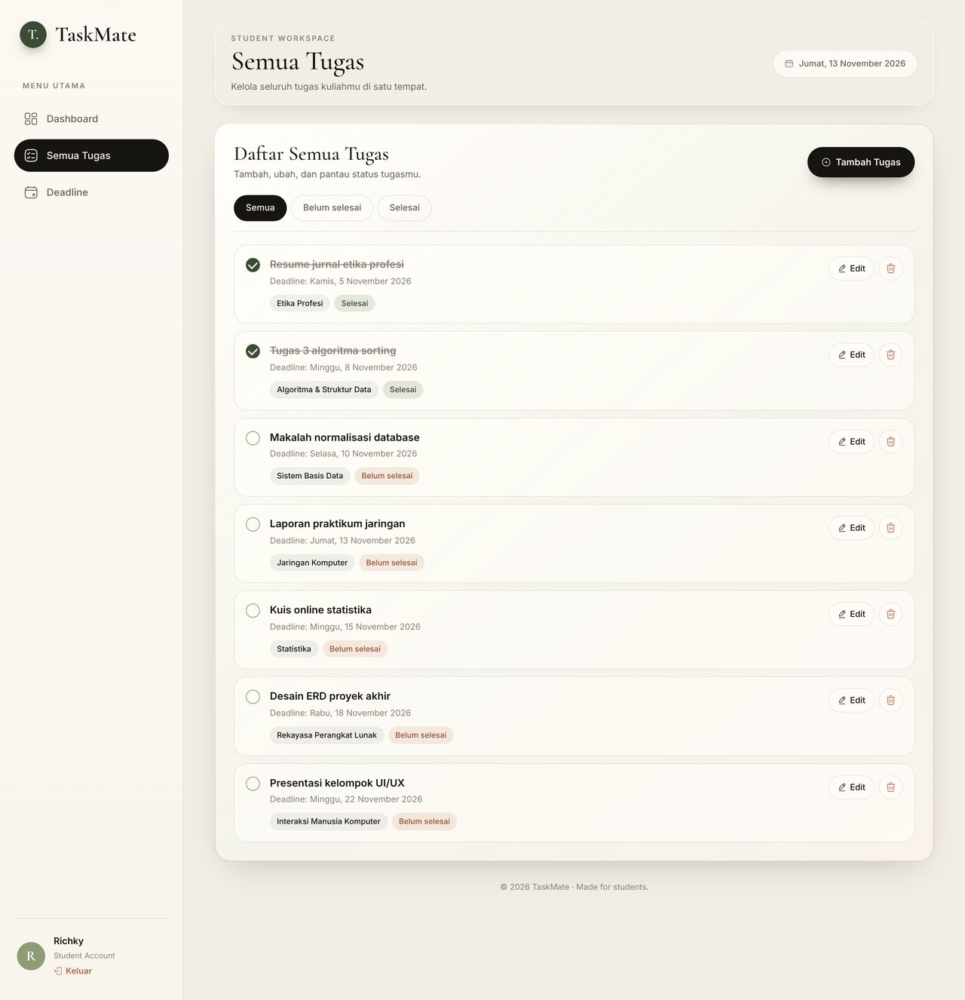
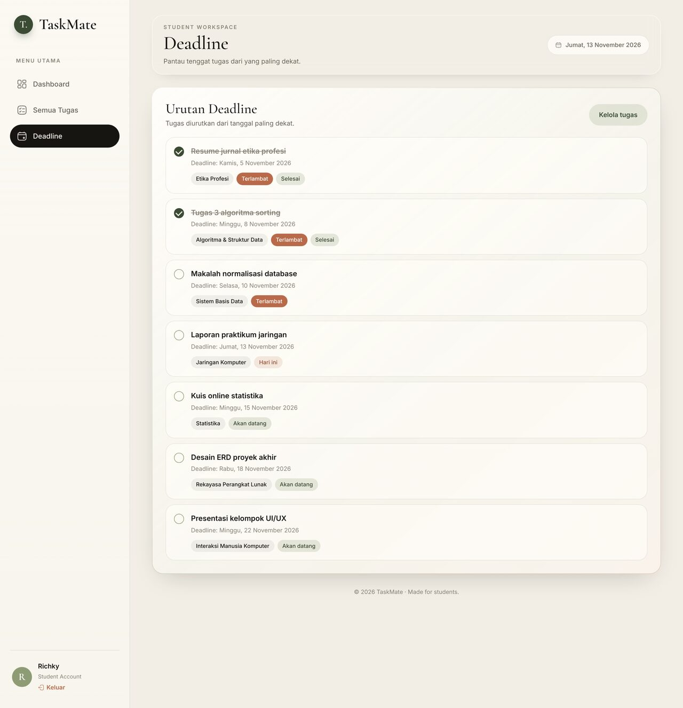
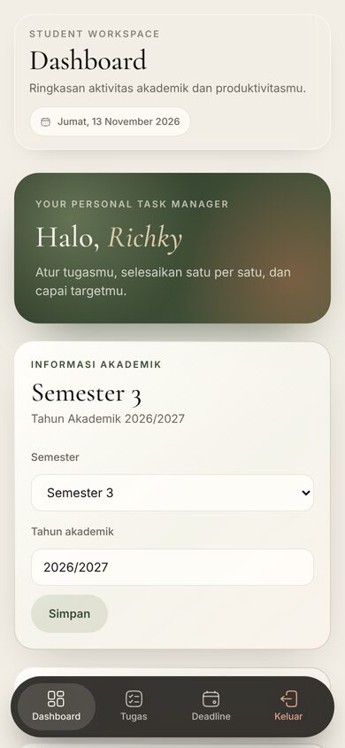

# TaskMate

Aplikasi web sederhana buat mahasiswa ngatur tugas kuliah: catat tugas per mata kuliah, pantau deadline, dan lihat progres belajar dalam satu dashboard.

**Demo:** [taskmate.infinityfree.io](https://taskmate.infinityfree.io)



## Fitur

- **Akun pengguna**: daftar, login, logout, dan reset password.
- **Dashboard**: info semester dan tahun akademik, jumlah tugas, persentase tugas selesai, dan daftar tugas terdekat.
- **Semua Tugas**: tambah, edit, hapus, tandai selesai, dan filter tugas.
- **Deadline**: tugas diurutkan berdasarkan tanggal, dengan penanda *terlambat*, *hari ini*, dan *akan datang*.
- **Responsif**: enak dipakai di laptop maupun HP.

## Tampilan

| Login | Semua Tugas | Deadline |
| --- | --- | --- |
|  |  |  |

<p align="center"></p>

## Teknologi

- PHP native (tanpa framework) + PDO
- MySQL / MariaDB
- HTML, CSS, dan JavaScript biasa (tanpa build tool)
- Font Cormorant Garamond & Inter (Google Fonts), ikon Iconify

## Menjalankan di komputer sendiri (XAMPP)

1. Clone repo ini (atau download ZIP dari GitHub), lalu beri nama foldernya `TaskMate`.
2. Pindahkan folder itu ke `htdocs` XAMPP, misalnya `C:\xampp\htdocs\TaskMate`.
3. Buka XAMPP Control Panel, nyalakan **Apache** dan **MySQL**.
4. Buka phpMyAdmin (`http://localhost/phpmyadmin`), buat database bernama `taskmate`, pilih database itu, lalu import `database.sql`.
5. Cek pengaturan koneksi di `config/database.php`. Bawaannya:

   | Host | Port | Database | User | Password |
   | --- | --- | --- | --- | --- |
   | `127.0.0.1` | `3307` | `taskmate` | `root` | *(kosong)* |

   Kalau MySQL XAMPP kamu pakai port standar, ganti `3307` jadi `3306`.
6. Buka `http://localhost/TaskMate/`, daftar akun baru, lalu login.

> Kalau database `taskmate` sudah berisi data, tidak perlu import `database.sql` lagi.
> Kalau tampilan belum berubah setelah update file, tekan `Ctrl + F5`.

## Deploy ke hosting

Panduan upload ke hosting gratis (InfinityFree) ada di **[DEPLOY.md](DEPLOY.md)**.

## Struktur folder

```
TaskMate/
├── api/
│   ├── tasks.php            # API tugas (GET, POST, PUT, PATCH, DELETE)
│   └── profile.php          # API simpan semester & tahun akademik
├── config/
│   ├── database.php         # koneksi database (bawaan untuk XAMPP)
│   ├── config.example.php   # contoh pengaturan database untuk hosting
│   └── auth.php             # session & helper login
├── docs/screenshots/        # gambar untuk README
├── index.php                # halaman utama (Dashboard, Semua Tugas, Deadline)
├── login.php, register.php, logout.php
├── forgot_password.php, reset_password.php
├── script.js, ui.js         # logika frontend
├── style.css                # tampilan
└── database.sql             # struktur tabel database
```
